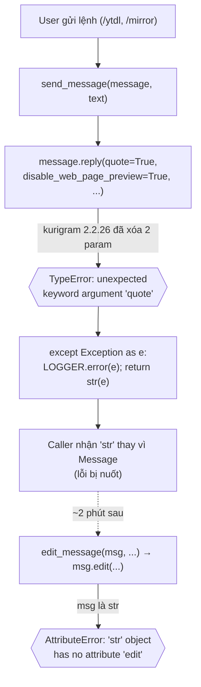

# Fix: kurigram 2.2.26 xóa deprecated params `quote` / `disable_web_page_preview`

| | |
|---|---|
| **Ngày** | 2026-10-30 |
| **Status** | Planned — sẽ execute ở session khác |
| **Branch** | `master` |
| **kurigram** | Đang cài = `2.2.26`; pin hiện tại = `>=2.2.26, <3` ([pixi.toml:49](../../pixi.toml)) |
| **Files liên quan** | `message_utils.py`, `telegram_uploader.py`, `restart.py`, `pixi.toml`, `requirements.txt` |

---

## 1. Mục tiêu (Why)

Bot crash runtime khi xử lý lệnh (vd `/ytdl`, `/mirror`) với **2 lỗi liên tiếp**:

```
2026-10-30 12:58:46 - bot - ERROR - Message.reply() got an unexpected keyword argument 'quote'
2026-10-30 13:00:46 - bot - ERROR - 'str' object has no attribute 'edit'
```

Mục tiêu: khôi phục luồng send/edit message trên kurigram hiện tại, chọn **1 trong 2 hướng** (pin version hoặc migrate API), và chặn tái phát.

---

## 2. Root cause

### 2.1. API drift ở kurigram 2.2.26

kurigram giữ các param *deprecated* (`quote`, `disable_web_page_preview`, `reply_to_message_id`, `quote_text`, `quote_entities`) ở **đuôi** signature `Message.reply()` như một lớp tương thích ngược — **tới hết v2.2.25**, rồi **xóa hẳn ở v2.2.26**.

| kurigram | `quote` trong `reply()` | `disable_web_page_preview` | Ghi chú |
|---|:---:|:---:|---|
| 2.2.0 → **2.2.25** (2026-08-21) | ✅ | ✅ | deprecated alias, vẫn chạy |
| **2.2.26** (2026-09-12) | ❌ | ❌ | **removed** — bản đang cài/pin |

API mới thay thế:
- `quote=True` → **bỏ** (bound method `message.reply()` / `message.reply_document()` / `reply_photo()` ... tự động reply vào message gốc qua `reply_parameters`, nên `quote=True` giờ là mặc định).
- `disable_web_page_preview=True` → `link_preview_options=LinkPreviewOptions(is_disabled=True)`.
- Áp dụng cho **cả** `message.edit()` (alias của `edit_text()`): 2.2.26 cũng chỉ nhận `link_preview_options`, không còn `disable_web_page_preview`.

`LinkPreviewOptions` có sẵn: `from pyrogram.types import LinkPreviewOptions`.

### 2.2. Error cascade — vì sao 1 gốc sinh ra 2 lỗi



- Lỗi #1 (`reply() ... 'quote'`): `send_message()` ([message_utils.py:16](../../bot/helper/telegram_helper/message_utils.py)) gọi `reply(quote=True, disable_web_page_preview=True, ...)` → `TypeError`.
- `send_message` nuốt exception và `return str(e)` ([message_utils.py:29](../../bot/helper/telegram_helper/message_utils.py)).
- Lỗi #2 (`'str' ... 'edit'`): caller lưu kết quả như `Message`, sau đó gọi `.edit()` trên cái `str` → `AttributeError`. Khớp đúng 2 mốc log cách nhau ~2 phút.

> ⚠️ Lưu ý: lỗi `.edit()` trên `str` đang **che** một break thứ 2 — ngay cả `edit_message()` cũng truyền `disable_web_page_preview=True` ([message_utils.py:38](../../bot/helper/telegram_helper/message_utils.py)), nên nếu chỉ fix `reply()` mà quên `edit()` thì sẽ lộ lỗi `edit_text() ... unexpected keyword argument` ngay sau đó (chỉ với Option B).

---

## 3. Phạm vi ảnh hưởng

Codebase dùng **API cũ ở 16 chỗ / 3 file**, và **0 chỗ** dùng API mới (`link_preview_options` / `reply_parameters` không xuất hiện trong `bot/`). ⇒ hạ version (Option A) là sạch (không lẫn API); migrate (Option B) cũng dứt điểm một lần.

| File | Lines | Param cũ |
|---|---|---|
| `bot/helper/telegram_helper/message_utils.py` | 18, 55 | `quote=True` |
| | 19, 38 | `disable_web_page_preview=True` |
| `bot/helper/mirror_leech_utils/telegram_uploader.py` | 187, 204, 363, 393, 412, 427 | `quote=True` |
| | 102, 110, 126 | `disable_web_page_preview=True` |
| `bot/modules/restart.py` | 38, 45 | `disable_web_page_preview=True` |

---

## 4. Hai phương án

### Option A — Pin `kurigram==2.2.25` (unblock nhanh)

- **Ưu:** đổi 1–2 dòng; khớp 100% API mà code đang giả định; rủi ro bỏ sót = 0.
- **Nhược:** 2.2.25 vẫn là **deprecated shim** (đã bị upstream bỏ) → lần bump kurigram sau **vỡ lại y hệt**; mất bugfix/security của 2.2.26+.

### Option B — Migrate sang API mới (forward-compatible)

- **Ưu:** giữ được kurigram mới nhất; fix một lần, không tái phát; không gánh deprecated shim.
- **Nhược:** đụng 16 call-site / 3 file; phải nhớ migrate **cả** `edit()`; cần test kỹ vài luồng (mirror/leech/ytdlp/restart).

### Khuyến nghị

**Option B** là hướng chính thức (bền vững, vì codebase vốn 0 chỗ dùng API mới nên migrate gọn). **Option A** để dự phòng nếu cần chạy production gấp trong lúc chưa kịp test Option B. → Quyết định cuối để chốt khi execute.

---

## 5. Step-by-step

### 5.A — Option A (pin)

1. [pixi.toml:49](../../pixi.toml): `kurigram = ">=2.2.26, <3"` → `kurigram = "==2.2.25"`.
2. (Đồng bộ) [pixi.toml:22](../../pixi.toml) env `cli`: `kurigram = "*"` → `kurigram = "==2.2.25"`; [requirements.txt:24](../../requirements.txt): `kurigram` → `kurigram==2.2.25`.
3. `pixi install` (cập nhật `pixi.lock`).
4. Verify (xem mục 6).
5. Commit: chỉ stage `pixi.toml`, `pixi.lock`, `requirements.txt`.

### 5.B — Option B (migrate)

Quy tắc chung áp cho mọi call-site reply/edit/copy/reply_*:
- Bỏ hẳn kwarg `quote=True`.
- `disable_web_page_preview=True` → `link_preview_options=LinkPreviewOptions(is_disabled=True)`.
- Thêm `from pyrogram.types import LinkPreviewOptions` vào mỗi file cần (gộp với import pyrogram sẵn có).

1. **`message_utils.py`**: `send_message` (reply), `edit_message` (edit), `send_file` (reply_document) — áp quy tắc trên.
2. **`telegram_uploader.py`**: 6 chỗ `quote=True` (reply_photo/video/audio/document...) bỏ; 3 chỗ `disable_web_page_preview=True` (gồm `copy()`) đổi sang `link_preview_options`.
3. **`restart.py`**: 2 chỗ `disable_web_page_preview=True` đổi sang `link_preview_options` (đọc context trước — reply hay edit).
4. **Quét sót** trước khi coi là xong:
   ```bash
   grep -rnE "quote\s*=|disable_web_page_preview|reply_to_message_id|quote_text|quote_entities" bot/
   ```
   (bắt các biến thể `quote=False`, truyền qua kwargs, và các alias deprecated khác đã bị 2.2.26 xóa).
5. Compile-check bằng đúng interpreter 3.11:
   ```bash
   .pixi/envs/default/python.exe -m compileall bot/
   ```
6. Verify (xem mục 6).
7. Commit: chỉ stage các file đã sửa trong `bot/`.

---

## 6. Verification

- `pixi run bot` khởi động không còn `unexpected keyword argument 'quote'`.
- Chạy thử 1 lệnh thực tế (vd `/ytdl <url>` hoặc `/mirror <url>`): bot reply được message trạng thái, **không** còn `'str' object has no attribute 'edit'`, và status message **edit** cập nhật được.
- (Option B) thử thêm `/restart` để xác nhận 2 chỗ trong `restart.py`.

---

## 7. Rollback

- Option A: revert đổi version + `pixi install`.
- Option B: `git revert` commit migrate (hoặc checkout lại 3 file) + `pixi run bot`.

---

## 8. Phụ lục — Evidence

Lệnh dùng để xác định mốc version (bisect GitHub tags của `KurimuzonAkuma/pyrogram`):

```bash
# raw file theo tag vX.Y.Z; trích signature reply() và soi 'quote'
for v in 2.2.20 2.2.25 2.2.26; do
  curl -sL "https://raw.githubusercontent.com/KurimuzonAkuma/pyrogram/v$v/pyrogram/types/messages_and_media/message.py" \
  | awk '/async def reply\(/{f=1} f{print} f&&/\) ->/{exit}' | grep -cE '^\s*quote\s*[:=]'
done
# → 2.2.20:1  2.2.25:1  2.2.26:0
```

Ràng buộc khi execute (theo `000-general-rules.md` + CLAUDE.md):
- Code/identifier/comment: English. Diễn giải: tiếng Việt, giữ technical term tiếng Anh.
- **Không** `git add .` — chỉ stage file đã tạo/sửa. Không commit secrets (`config.py`, `.env`, `*.conf`, ...).
- Dùng `pixi` (không pip/uv trực tiếp). Dùng `LOGGER`, không `print`.
- Commit subject có `skip ci` nếu muốn CI bỏ qua.
