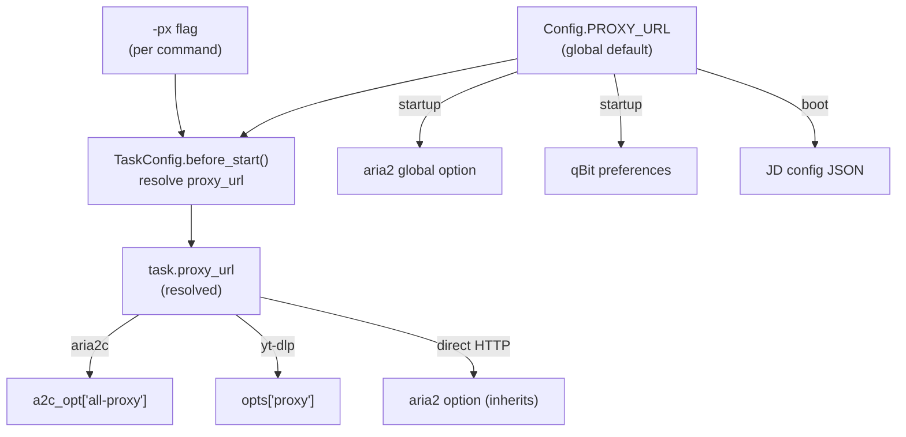

# PROXY_URL — SOCKS5 Proxy for Download Engines

## Requirement

Add a unified proxy config (`PROXY_URL`) for all download engines (aria2c, qBittorrent, yt-dlp, JDownloader, Direct HTTP).
Exclude: Telegram (has own `TG_PROXY`), Google Drive API, Rclone, SABnzbd (no native SOCKS5).

Per-task override via `-px` command flag.

## Architecture

## Flag `-px` behavior

| Command | Proxy used |
|---------|-----------|
| `/mirror link` | `Config.PROXY_URL` (global default) |
| `/mirror -px link` | No proxy (disabled for this task) |
| `/mirror -px socks5://x:1080 link` | Override URL for this task |
| `/ytdl -px link` | No proxy for this yt-dlp download |

## Per-engine proxy injection

| Engine | Method | Per-task |
|--------|--------|---------|
| aria2c | `all-proxy` per-download option | Yes |
| qBittorrent | Global preferences at startup | No (global only) |
| yt-dlp | `opts["proxy"]` | Yes |
| JDownloader | Config JSON at boot | No (global only) |
| Direct HTTP | Via aria2c (inherits) | Yes |

## Implementation

### Step 1: Config key
- `bot/core/config_manager.py` — add `PROXY_URL = ""` to `Config` class

### Step 2: Per-task attribute
- `bot/helper/common.py` — add `self.proxy_url = None` to `TaskConfig.__init__`
- Resolve in `before_start()`: if `proxy_url is None` → use `Config.PROXY_URL`

### Step 3: Command flag `-px`
- `bot/helper/ext_utils/bot_utils.py` — add `"-px"` to `bool_arg_set`
- `bot/modules/mirror_leech.py` — add `"-px": None` to args dict, parse result
- `bot/modules/ytdlp.py` — same pattern

### Step 4: Engine injection
- `bot/core/startup.py` — `_parse_proxy_url()`, `_apply_qb_proxy()`, aria2 global proxy
- `bot/core/jdownloader_booter.py` — write JD InternetConnectionSettings.json
- `bot/helper/mirror_leech_utils/download_utils/aria2_download.py` — per-task `all-proxy`
- `bot/helper/mirror_leech_utils/download_utils/direct_downloader.py` — per-task `all-proxy`
- `bot/helper/mirror_leech_utils/download_utils/yt_dlp_download.py` — `opts["proxy"]`

### Step 5: Hot-reload via /bsettings
- `bot/modules/bot_settings.py` — handle PROXY_URL set/reset: apply to aria2c + qBittorrent live

## Not touched (excluded from proxy)
- `bot/core/mltb_client.py` — Telegram (own `TG_PROXY`)
- `bot/helper/mirror_leech_utils/gdrive_utils/` — Google Drive API
- `bot/helper/mirror_leech_utils/rclone_utils/` — Rclone
- SABnzbd — no native SOCKS5 support
